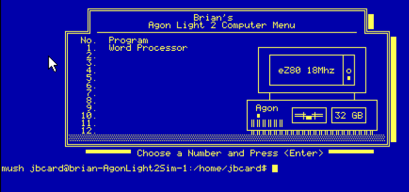

# 1-Nov-2026 - Graphics!! (Well, kind of...)

I think this update will be remembered for two things:
1. This is the point at which I **FINALLY** got a video driver working
2. This is the point at which I started turning over more development to Claude

Let's talk about the second one first.  There are certain things about this effort that I absolutely want to do and there are others that I want as little involvement with as possible.  Most of the kernel stuff is where my main focus is.  The main exception to that is the filesystem.  At some point, I'd like to at least try to develop my own filesystem.  Until then, I'm just implementing somebody else's and I have zero interest in that.  Over time, I've had Claude develop FAT16, exFAT, and FAT32 drivers.  I've had to intervene a few times when it made some poor decisions but, overall, I've tried to stay out of it.

The overall architecture of the system has been my design.  There's no way Claude could ever have come up with this arrangement.  I'm not aware of anything else like it, so there's nothing it could have trained on to even suggest this.  I've implemented most of the code myself, including all the HAL implementations.

Which brings me to the second thing I really don't want to get into:  hardware.  I've designed this system to be hardware-agnostic.  My work is on building out the infrastructure to make it a usable operating system.  Hardware details are a necessary evil.  I reeeeeeeally didn't want to have to learn eZ80 assembly or the specifics of this Agon Light 2 board that I wanted to port the OS to.  So, for the porting effort, I've tried to offload the work onto Claude as much as possible.

I say "as much as possible" because there have been times I've had to intervene.  I've had to hand-optimize some assembly to make hot paths a few instructions shorter and squeeze every clock cycle I could out of this 18 MHz, 8-bit chip.  Claude definitely got most of the way there, but the overall effort was not without a human component.

Then came the big deal:  keyboard/video/mouse setup.  I specifically got this SBC because it was the closest thing I could find to the 8088 I had as a kid. It has 128 KB of flash, 520 KB of RAM, and an 18 MHz, 8-bit eZ80 CPU. Up until running NanoOs on it, the only real hardware NanoOs had run on was Arduinos, which only gave me UART as a means of a user interface. I really wanted to get to the point of having a real keyboard/video/mouse setup to play with.

Well, last week, I finally got the KVM console port working on this board. To do that, I had to implement a driver for the board's ESP32 VDP processor. Now, the cool thing about this is that the core kernel processes of the OS have absolutely no idea about it, nor does the HAL. The VDP driver is just another process and it's configured by reading /etc/config.sys at boot time. There's nothing anywhere in any of the boot code that knows anything at all about keyboards, video, or mice. To the console process, it's just another port.

The default font on the VDP is an 8x8 font that I didn't like. It looked "clunky" to me. So, I implemented a 6x8 font instead. Once I'd done that, I thought about what the non-ASCII bytes should be and decided to go with the old IBM code page 437 character set used on IBM PCs.

Full disclosure: I absolutely used AI to implement the VDP driver. First off, understanding VDP protocol was not something I wanted to do. Secondly, no living human should have to implement a code page 437 bitmap in this day and age. Claude is absolutely the right tool for the job for that.

Once I had that implemented, I thought about the old text-based menus I had on my XT as a kid. We had this system of menus and batch files that would make things a little simpler to navigate back in the DOS days. I knew I still had a copy of them on a CD somewhere but I couldn't remember where I put the CD. Well, I never found the CD, but I did flip through a pile of floppy disks I had and one of them was labeled "Menus and Batch Files". I grabbed my USB floppy drive and made an image of the disk, mounted it in Linux and... voila!! All the menus were still there!!!

Back in the DOS days, we had a command that would change the color of the screen. Then, we had the main menu print out in autoexec.bat on boot. I didn't want to do that across the board since I'm going for a system that's somewhat Unix-like, but I thought it would be cool to have a user account that did that on login. I used Claude to generate a "color" command and then to extend my shell to handle a .profile file on login so that it would run something once on login. Put all that together and *poof!!* It's like I'm running multi-user DOS now!! Hooray!!!

This is step one in a much larger effort now. I tried to put all this together in a way that would allow me to develop a graphical desktop environment. I was pleased to see that there were very few modifications that were needed to the core infrastructure that was already there. The changes to get from a strictly-UART interface to one that supported a video terminal were mostly additive, which gives me some confidence in the design.

Onward and upward!! HUZZAH!!

To be continued...

[Table of Contents](.)
